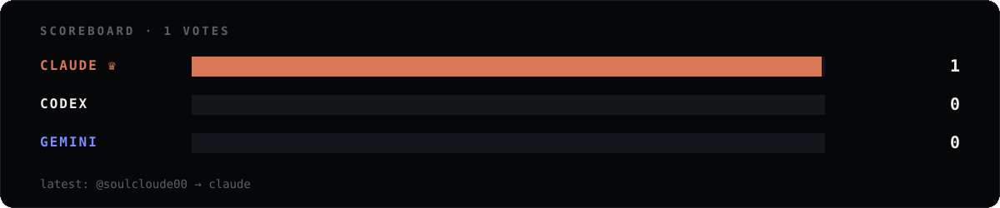

  

  
  
  

  

click an agent, hit <b>create</b>, and a bot counts your vote and redraws the scoreboard. 
arena by <b>haresh</b>. building agents that do actual work.
&nbsp;·&nbsp; <a href="https://twitter.com/soulcloude00">twitter</a>
&nbsp;·&nbsp; <a href="https://linkedin.com/in/soulcloude00">linkedin</a>
&nbsp;·&nbsp; <a href="mailto:soulcloude00@gmail.com">email</a>

